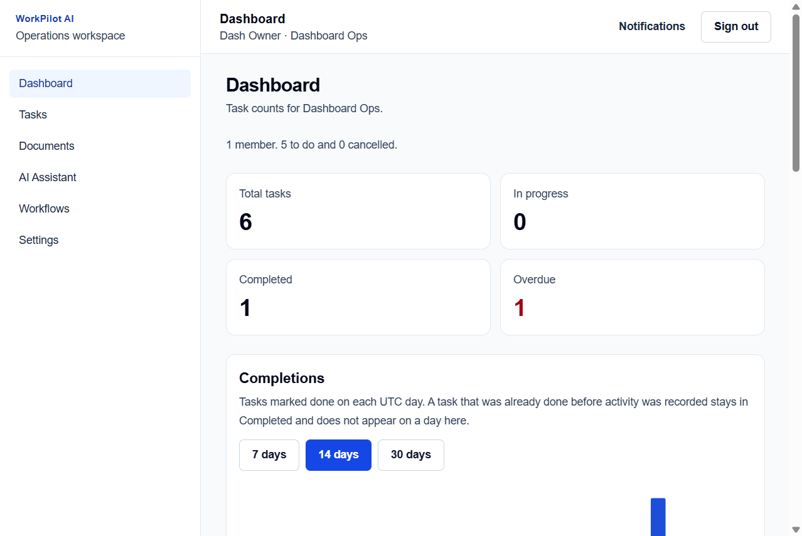
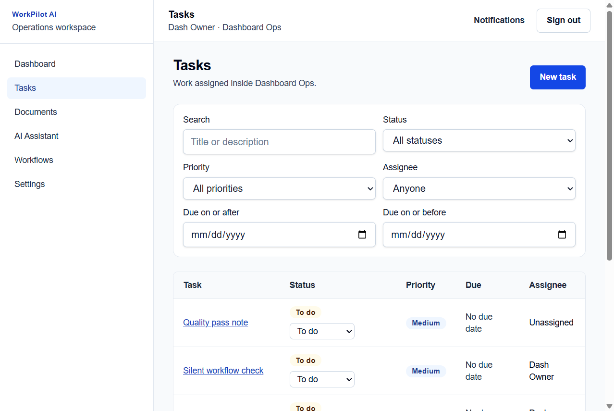
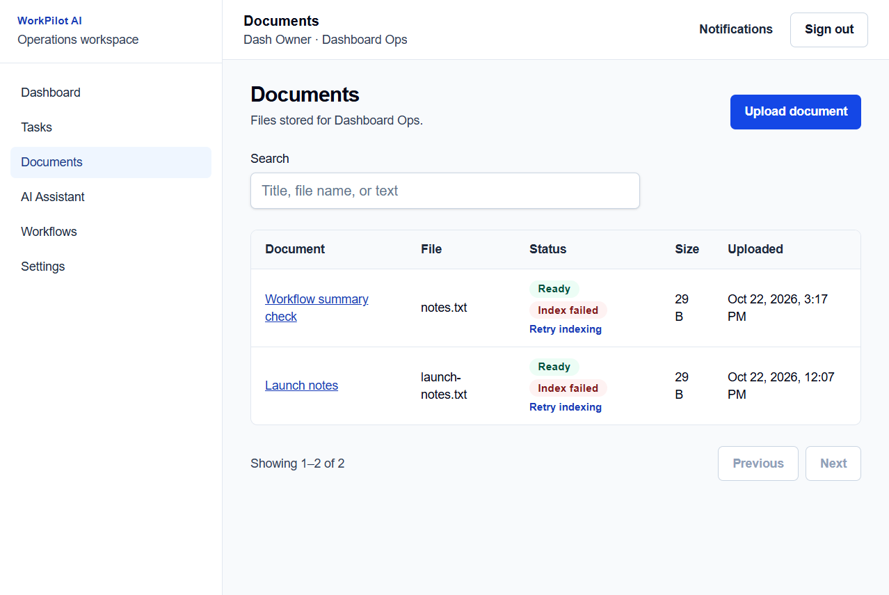
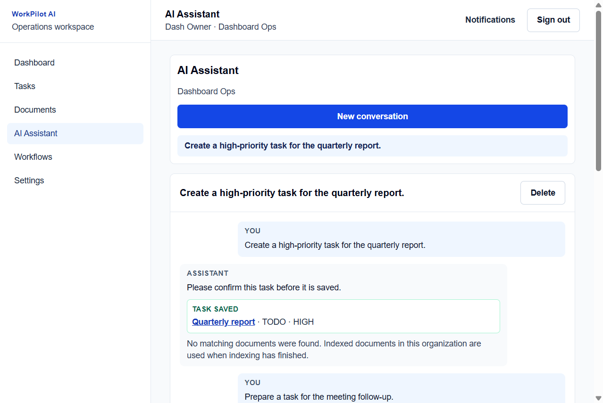
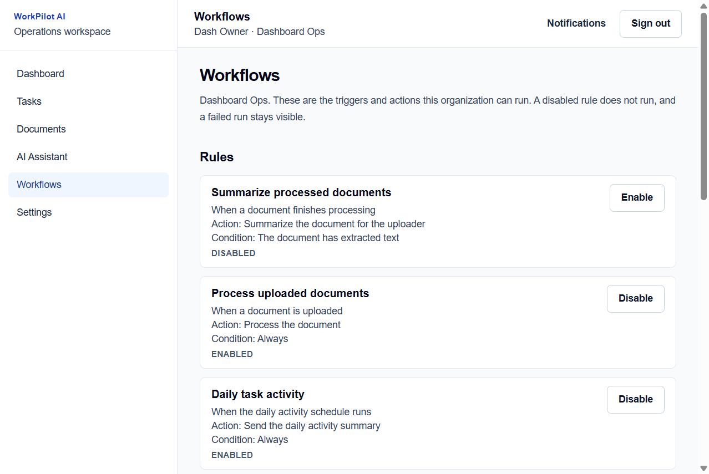
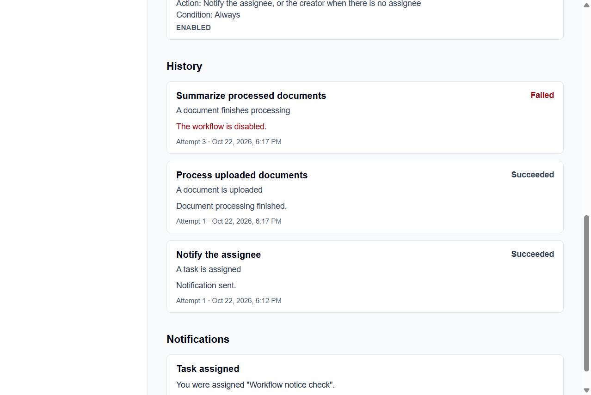
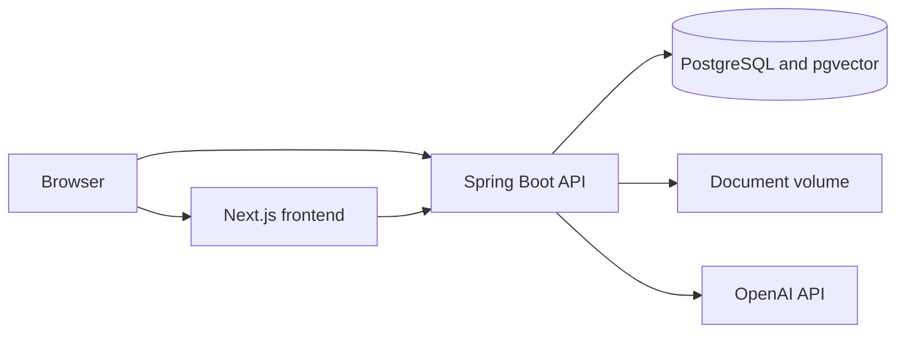

# WorkPilot AI

WorkPilot AI is a multi-tenant operations workspace. A person registers an account, creates an organization, and works with tasks, documents, an assistant, workflow rules, and an organization dashboard. Each organization is isolated from the others.

## Core features

- Accounts, organizations, and owner, admin, and member roles
- Task list with status, priority, assignee, due date, search, and filters
- Document upload, text extraction, chunking, and pgvector indexing
- Assistant conversations that can look up tasks, confirm a new task, and cite indexed documents
- Workflow rules for assignment notices, overdue tasks, document processing, optional summaries, and a daily activity digest
- In-app notifications with unread counts
- Dashboard counts and a completion trend

The screenshots below are the local organization **Dashboard Ops**, captured from the running application on 22 October 2026. The counts belong to that local data.













A short case study is in [docs/CASE_STUDY.md](docs/CASE_STUDY.md).

## Technology stack

| Area | Choice |
| --- | --- |
| Frontend | Next.js 16.4.1 (App Router), React 19.3.0, TypeScript 5.9.3, Tailwind CSS 4.3.3, ESLint 9.39.5, npm |
| Backend | Java 21, Spring Boot 3.5.16, Maven, Spring Web, Spring Data JPA, Spring Security, Validation, Actuator, Flyway, PostgreSQL JDBC, Springdoc OpenAPI 2.8.14 |
| Database | PostgreSQL 17 with pgvector, image `pgvector/pgvector:pg17` |
| Infrastructure | Docker, Docker Compose, environment files |

## Architecture

The browser loads the Next.js application and calls the Spring Boot API directly. The public API origin is baked into the frontend at build time. The API stores relational data and chunk embeddings in PostgreSQL, stores uploaded files on a volume, and calls OpenAI only when `OPENAI_API_KEY` is set.



Local development publishes the frontend on port 3000, the API on port 8081, and PostgreSQL on port 5434. The production overlay removes those published ports and expects a TLS reverse proxy on the Docker network. See [deploy/Caddyfile](deploy/Caddyfile).

## Database design

Flyway owns the schema. Hibernate validates it and does not create or drop tables. Shared migrations live in `backend/src/main/resources/db/migration`. The pgvector migration is PostgreSQL-only and lives in `backend/src/main/resources/db/vendor/postgresql`.

| Table | What it stores |
| --- | --- |
| `users` | Account email, display name, and BCrypt password hash |
| `organizations` | Organization name |
| `organization_memberships` | User membership and role `OWNER`, `ADMIN`, or `MEMBER` |
| `tasks` | Organization task, status, priority, assignee, and due date |
| `documents` | Organization file metadata, storage key, processing status, and extracted text |
| `document_chunks` | Ordered text chunks. PostgreSQL adds an `embedding vector(1536)` column |
| `activity_events` | Task activity used by the dashboard and the daily digest |
| `conversations` | Assistant conversation owned by one member |
| `conversation_messages` | Messages in that conversation |
| `message_sources` | Document passages cited by a reply |
| `assistant_tool_calls` | Task lookup and confirmed task creation |
| `workflow_rules` | One rule per organization and event |
| `workflow_executions` | Run status, attempt count, and the latest error |
| `notifications` | In-app notice for one user |

Organization-owned rows include `organization_id`. A caller who is not a member receives 404 for that organization's resources.

| Version | Purpose |
| --- | --- |
| `V1__initial_schema.sql` | `users`, `organizations`, and `organization_memberships` |
| `V2__membership_role_check.sql` | Restricts membership roles to `OWNER`, `ADMIN`, and `MEMBER` |
| `V3__tasks.sql` | Organization tasks, with status and priority checks |
| `V4__documents.sql` | Organization documents and allowed file types |
| `V5__activity_events.sql` | Task activity used by the dashboard |
| `V6__document_processing.sql` | Document storage keys and processing status |
| `V7__conversations.sql` | Assistant conversations and messages |
| `V8__document_chunks.sql` | Document chunks, indexing status, and answer sources |
| `V9__pgvector.sql` | PostgreSQL `vector` extension and similarity index |
| `V10__assistant_tool_calls.sql` | Assistant task lookup and confirmed task creation |
| `V11__workflows.sql` | Workflow rules, execution history, and in-app notifications |

## Repository structure

```text
frontend/                 Next.js application
backend/                  Spring Boot application
infrastructure/docker/    PostgreSQL init mount. Schema comes from Flyway.
docs/                     API reference, case study, and screenshots
deploy/Caddyfile          Example TLS proxy. It is not started by Compose.
docker-compose.yml        Local postgres, backend, and frontend
docker-compose.prod.yml   Production overlay. It was not started.
.env.example              Local placeholders
.env.production.example   Deployment placeholders
```

## Local development

### Prerequisites

- Node.js 24 and npm 11 (verified with Node.js 24.18.0 and npm 11.4.1)
- JDK 21 or a newer JDK that can compile Java 21 bytecode. This machine uses Temurin 25.0.2. JDK 21 itself is not installed. Docker runs the backend on Eclipse Temurin 21.
- Maven 3.6.3 or later (verified with Maven 3.9.9)
- Docker Engine with Docker Compose v2 (verified with Docker 29.4.1 and Compose v5.1.3)
- Git

### Environment setup

From the repository root:

```powershell
Copy-Item .env.example .env
Copy-Item backend\.env.example backend\.env
Copy-Item frontend\.env.example frontend\.env
```

`.env.example` files are tracked. Real `.env` files are gitignored. The checked-in password value `change-me` is a local development placeholder. Replace it before using this project in any shared or deployed environment.

Host ports:

| Service | URL or address |
| --- | --- |
| Frontend | http://localhost:3000 |
| Backend | http://localhost:8081 |
| PostgreSQL | `localhost:5434` |

Port `5432` is not used because a local PostgreSQL server is already listening there. Port `5433` is already used by another Docker database (`smartbill-postgres`).

### Run on the host

Use this when you want Next.js and Spring Boot hot reload on the host, with only PostgreSQL in Docker.

1. Start the database:

```powershell
docker compose up -d postgres
```

2. Start the backend from `backend/` so it loads `backend/.env`:

```powershell
cd backend
mvn spring-boot:run
```

3. In another terminal, start the frontend:

```powershell
cd frontend
npm install
npm run dev
```

The backend on the host connects to `localhost:5434`. The browser calls `http://localhost:8081`.

Do not run the host backend and the Compose backend at the same time. Both bind port `8081`. The same applies to the frontend and port `3000`.

| | Local processes | Docker Compose |
| --- | --- | --- |
| Frontend | `npm run dev` in `frontend/` | `workpilot-frontend` on port 3000 |
| Backend | `mvn spring-boot:run` in `backend/` | `workpilot-backend` on port 8081, Temurin 21 |
| Database | `docker compose up -d postgres` | same `workpilot-postgres` service |
| JDBC host | `localhost:5434` | `postgres:5432` |
| Browser API URL | `http://localhost:8081` | `http://localhost:8081` |
| Server-side API URL | `http://localhost:8081` | `http://backend:8081` |

## Environment variables

Credentials come from the environment. The examples contain placeholders only.

| Variable | Used by | Purpose |
| --- | --- | --- |
| `POSTGRES_DB` | Compose | Database name, `workpilot_db` |
| `POSTGRES_USER` | Compose | Database user |
| `POSTGRES_PASSWORD` | Compose | Database password |
| `POSTGRES_PORT` | Compose | Host port for PostgreSQL. Local default `5434` |
| `SPRING_DATASOURCE_URL` | Backend | JDBC URL |
| `SPRING_DATASOURCE_USERNAME` | Backend | JDBC user |
| `SPRING_DATASOURCE_PASSWORD` | Backend | JDBC password |
| `SERVER_PORT` | Backend | API port. Default `8081` |
| `SESSION_COOKIE_SECURE` | Backend | `false` for local HTTP. `true` behind HTTPS |
| `CORS_ALLOWED_ORIGINS` | Backend | Exact browser origin. Local default `http://localhost:3000` |
| `DOCUMENT_STORAGE_DIR` | Backend | File directory. Host default `data/documents`. Compose uses the `workpilot_documents` volume |
| `OPENAI_API_KEY` | Backend | Optional. Empty means the assistant reports that it is not configured |
| `OPENAI_MODEL` | Backend | Chat model. Default `gpt-4o-mini` |
| `OPENAI_BASE_URL` | Backend | Default `https://api.openai.com/v1` |
| `OPENAI_TIMEOUT` | Backend | Default `30s` |
| `EMBEDDING_MODEL` | Backend | Default `text-embedding-3-small` |
| `EMBEDDING_MODEL_VERSION` | Backend | Default `3` |
| `EMBEDDING_DIMENSIONS` | Backend | Default `1536` |
| `VECTOR_STORE` | Backend | Default `pgvector` |
| `NEXT_PUBLIC_API_BASE_URL` | Frontend build | Public API origin baked into the browser bundle. It must not contain secrets |
| `API_BASE_URL` | Next.js server | Server-side API origin. Compose uses `http://backend:8081` |
| `SPRING_PROFILES_ACTIVE` | Backend | Set to `prod` for the production profile |

Request and AI limits are set in `backend/src/main/resources/application.yml`: uploads are 10 MB, chat messages are 4,000 characters, each member can send 40 assistant messages per UTC day, a reply is limited to 800 output tokens, and each assistant request allows 3 tool calls inside 15 seconds.

## Docker

Local stack:

```powershell
docker compose up --build
```

Add `-d` to run in the background. Stop the stack with:

```powershell
docker compose down
```

`docker compose down` keeps the named volumes `workpilot_postgres_data` and `workpilot_documents`. Do not add `-v` unless you intend to delete the database and the uploaded files.

Inside Compose:

- The backend uses the hostname `postgres` and port `5432`.
- Browser code still uses `http://localhost:8081`, because that code runs in the user's browser.
- Server-side frontend code receives `API_BASE_URL=http://backend:8081`.
- `NEXT_PUBLIC_API_BASE_URL` is embedded when the frontend image is built. Change it in `.env`, then rebuild the frontend image.
- The backend image skips tests during `mvn package`. Run tests on the host before building a release image.

The production overlay is `docker-compose.prod.yml`. It sets `SPRING_PROFILES_ACTIVE=prod`, requires `CORS_ALLOWED_ORIGINS`, sets the session cookie secure, and removes the published PostgreSQL, API, and frontend ports. Validate the merge without starting it:

```powershell
$env:CORS_ALLOWED_ORIGINS = 'https://app.example.com'
docker compose -f docker-compose.yml -f docker-compose.prod.yml config
```

That overlay was validated and was not started. It must not be pointed at this machine's development database.

## Testing

Backend tests, from `backend/`:

```powershell
mvn test
mvn -DskipTests package
```

`mvn test` uses an in-memory H2 database for the shared migrations and one Testcontainers test against `pgvector/pgvector:pg17` when Docker is available. That test does not use the development database on port 5434.

Frontend checks, from `frontend/`. There is no browser test runner.

```powershell
npm run lint
npm run typecheck
npm run build
```

## API documentation

The endpoint reference is [docs/API.md](docs/API.md). With the local profile, Springdoc is also at `http://localhost:8081/swagger-ui.html`. The `prod` profile disables `springdoc.api-docs` and `springdoc.swagger-ui`.

Health:

```text
http://localhost:8081/actuator/health
http://localhost:8081/actuator/health/readiness
```

An anonymous health check returns `"status":"UP"` and leaves out component details. A signed-in caller also sees the `db` component. Container health checks call `/actuator/health/readiness` and only need HTTP 200.

## Deployment

No public deployment was created, and no hosting account or paid resource was provisioned. There is no deployment URL.

A compatible target is one Linux virtual machine running this Compose stack behind a TLS reverse proxy. PostgreSQL with pgvector and the document volume stay on that machine, so a separate managed database is not required. A practical size for this application is about 2 vCPU, 4 GB of memory, and 40 GB of disk.

That virtual machine is a paid service. Small general-purpose machines are commonly in the range of a few dollars to the mid-teens per month. Those figures are an estimate, not a quote, and prices were not checked against a provider. OpenAI is a separate usage-based charge when a key is configured. Caddy can obtain a certificate from Let's Encrypt, which does not charge for the certificate and does require a public hostname plus ports 80 and 443. None of those services were purchased.

Preparation that is already in the repository:

1. Copy `.env.production.example` into the secret store you will use. Replace every placeholder. Do not commit that file.
2. Build the frontend with `NEXT_PUBLIC_API_BASE_URL` set to the public HTTPS API origin, for example `https://api.example.com`.
3. Put the frontend and API on hostnames that share a registrable domain, such as `app.example.com` and `api.example.com`, so the `SameSite=Lax` session cookie is sent on browser calls to the API.
4. Set `CORS_ALLOWED_ORIGINS` to the exact frontend origin, `SESSION_COOKIE_SECURE=true`, and `SPRING_PROFILES_ACTIVE=prod`.
5. Terminate TLS in a proxy such as [deploy/Caddyfile](deploy/Caddyfile). Leave the application ports unpublished. The production profile trusts forwarded headers, so the API must not be reachable except through that proxy.
6. Start with `docker compose -f docker-compose.yml -f docker-compose.prod.yml up -d --build` only after the environment points at a new empty database. Flyway applies pending migrations on startup. The production profile sets `baseline-on-migrate` to false, so a non-empty database without Flyway history fails closed.
7. Confirm `GET /actuator/health/readiness` returns 200 through the proxy.

The production profile also turns off Swagger, uses a 20 second graceful shutdown, and keeps logs at INFO on stdout. Unhandled exceptions are written by the API's exception handler. No external error-reporting service was added.

Restarting the API signs everyone out. Sessions are stored in memory. Restarting PostgreSQL does not remove data. The API reconnects through its connection pool.

## Backup and restore

These commands were not run against the development database. A dump contains account and organization data. Keep it outside the repository.

Database backup from the Compose network:

```powershell
docker compose exec postgres pg_dump -U workpilot -d workpilot_db -Fc -f /tmp/workpilot.dump
docker compose cp postgres:/tmp/workpilot.dump .\workpilot.dump
```

Restore into an empty database, then start the API so Flyway can validate the schema:

```powershell
docker compose cp .\workpilot.dump postgres:/tmp/workpilot.dump
docker compose exec postgres pg_restore -U workpilot -d workpilot_db --clean --if-exists /tmp/workpilot.dump
```

Document files live in the `workpilot_documents` volume, or in `DOCUMENT_STORAGE_DIR` for a host process. Archive that directory with the database dump. Restoring one without the other leaves document rows pointing at missing files, or files with no rows. Stop the API before a restore so it is not writing during the copy.

## Known limitations

- Nothing has been deployed. There is no public URL.
- Sessions are in memory, so an API restart signs users out.
- Sign-in does not lock an account after repeated failures.
- Swagger UI is public unless the `prod` profile, or the Springdoc flags, disable it.
- `SESSION_COOKIE_SECURE` defaults to false so local HTTP works.
- Word `.docx` files are accepted from ZIP magic bytes and are stored for download. Their text is not extracted.
- Extracted text is capped at 20,000 characters.
- Document indexing and the optional document summary need `OPENAI_API_KEY`. The screenshots show indexing failed for that reason.
- The document summary workflow is disabled until an owner or admin enables it.
- Overdue and daily activity jobs run at 08:00 and 08:15 UTC.
- Settings is a placeholder page.
- Backend tests cover H2 plus one pgvector test. The frontend has lint, type checking, and a production build, and no browser test runner.
- `npm audit` reports high findings in the ESLint toolchain. The suggested fix downgrades `eslint-config-next` and was not applied. Java dependencies were not scanned with an NVD tool.
- This is a single-machine layout. It does not add a second API instance, a shared session store, or a managed database.

## Authentication

The API uses an HttpOnly session cookie named `WORKPILOT_SESSION`. Passwords are stored as BCrypt hashes. A browser client on `http://localhost:3000` can call the API with credentials. Other origins are rejected unless they are listed in `CORS_ALLOWED_ORIGINS`.

The frontend API client always sends `credentials: "include"` to `NEXT_PUBLIC_API_BASE_URL`. Before `POST`, `PATCH`, or `DELETE`, it calls `GET /api/auth/csrf` and sends the returned token in the `X-XSRF-TOKEN` header. The session cookie is not readable from JavaScript. A request that expected an existing session and receives `401` clears the local user and returns to the sign-in page.

`GET /actuator/health` stays public and does not require CSRF. Public responses include the overall status. Component details, including the database, are included for a signed-in caller.

Organization permissions are `OWNER`, `ADMIN`, and `MEMBER`. A user who is not a member of an organization receives `404` for that organization's resources. Missing permission is `403`. New organization-owned records should implement `OrganizationScoped` and pass through `OrganizationAccessService`.

## Frontend application

Public routes are `/login` and `/register`. `/` sends a signed-in user to `/dashboard` and everyone else to `/login`. These routes require a session:

| Route | Page |
| --- | --- |
| `/dashboard` | Task counts, completion trend, recent tasks, and recent activity |
| `/tasks` | Task list, filters, create, edit, status changes, and delete |
| `/documents` | Upload, search, download, edit, and delete organization files |
| `/assistant` | Conversations with the assistant |
| `/workflows` | Workflow rules, run history, and notifications |
| `/settings` | Placeholder |

Registration calls `POST /api/auth/register`, then `POST /api/auth/login`. The API does not start a session during registration. Sign-out calls `POST /api/auth/logout`. Reloading the page calls `GET /api/auth/me` and keeps the user in the shell while the session cookie is still valid.

## Tasks

Tasks belong to one organization. Create, read, and update use the resource permissions held by every role. Delete uses `RESOURCE_DELETE`, so owners and admins can delete tasks and members cannot.

A new task defaults to status `TODO` and priority `MEDIUM`. Creation may choose any status. Later status changes follow this lifecycle:

| From | Allowed next statuses |
| --- | --- |
| `TODO` | `IN_PROGRESS`, `CANCELLED` |
| `IN_PROGRESS` | `TODO`, `DONE`, `CANCELLED` |
| `DONE` | `IN_PROGRESS` |
| `CANCELLED` | `TODO` |

An assignee must be an active member of the same organization. The Tasks page lists, filters, searches, and pages tasks from `GET /api/organizations/{organizationId}/tasks`. The contract is in [docs/API.md](docs/API.md).

## Documents

Documents belong to one organization. Upload, read, and metadata updates use the resource permissions held by every role. Delete uses `RESOURCE_DELETE`, so owners and admins can delete documents and members cannot.

Accepted files are PDF, plain text, CSV, Markdown, PNG, JPEG, WebP, and Word `.docx`, up to 10 MB. The extension is checked against the file bytes, so a renamed file is rejected. PDF, text, CSV, and Markdown files are extracted in the background. Extraction ends as `COMPLETED` or `FAILED`. A failed document can be retried. Extracted text is capped at 20,000 characters and split into ordered chunks. PNG, JPEG, WebP, and Word files are stored for download and are not read for search.

A completed text extraction is queued for embedding. Indexing has its own status: `PENDING`, `PROCESSING`, `COMPLETED`, `FAILED`, or `SKIPPED`. Upload success does not mean an embedding was stored. A failed index can be retried. Deleting a document deletes its chunks and embeddings. The configured embedding model is `text-embedding-3-small`, version `3`, with 1,536 dimensions. A document indexed with a different model or dimension is reported as `STALE` until it is indexed again.

The database stores a storage key. The file itself stays in the configured directory, `data/documents` for a host backend and the `workpilot_documents` volume in Compose. Set `DOCUMENT_STORAGE_DIR` to move that directory. Replacing local files with object storage later means implementing the same storage key contract. Chunk embeddings use pgvector in PostgreSQL. Compose runs `pgvector/pgvector:pg17`.

The Documents page uploads, searches, pages, downloads, deletes, and retries files through `/api/organizations/{organizationId}/documents`. It also shows indexing status.

## AI Assistant

The assistant keeps a separate conversation history for each member of an organization. Another member of the same organization cannot open those conversations. A caller who is not a member of the organization receives `404`.

Set `OPENAI_API_KEY` in the backend environment. The chat model defaults to `gpt-4o-mini`. Embeddings use `text-embedding-3-small` at 1,536 dimensions. `OPENAI_BASE_URL` defaults to `https://api.openai.com/v1`, and `OPENAI_TIMEOUT` defaults to `30s`. The key stays on the server. Each member can send 40 messages per UTC day. A message can be 4,000 characters. The provider receives the system instruction, up to 20 earlier messages, and any retrieved document passages. Its reply is limited to 800 output tokens.

A missing key or a provider failure returns `503` with a short message. Reaching the daily limit returns `429`. Failed requests are not stored as assistant replies. The Assistant page can send the same draft again.

When indexed chunks exist for the organization, the assistant retrieves the closest passages and stores those sources with the reply. Passages are treated as untrusted data. If nothing relevant is retrieved, the reply is marked as having no document support and the page says that no matching documents were found.

The assistant can look up tasks and prepare a new task. Preparing a task does not save it. The member confirms the title, priority, and due date before the task service creates the task. The saved task is the one returned by that service, and the same confirmation cannot create a second copy. A caller who does not own the conversation cannot confirm the action. Tool arguments cannot choose an organization or a user id. Each request allows 3 tool calls and a 15 second tool budget.

## Workflows

Each organization starts with five workflows. Owners and admins can enable or disable them. Members can read the rules and the run history.

| Trigger | Action | Starts enabled |
| --- | --- | --- |
| A task is assigned | Notify the assignee | Yes |
| A task is overdue | Notify the assignee, or the creator when there is no assignee | Yes |
| A document is uploaded | Process the document | Yes |
| A document finishes processing and has extracted text | Summarize it for the uploader | No |
| Each day | Send the previous day's task activity | Yes |

A task assignment sends one notification for that assignee. The same assignment does not send another. The overdue check runs daily at 08:00 UTC and notifies once for a task and due date. Uploading a document starts processing through the workflow. If that rule is disabled, the upload stays stored and processing does not start. The document summary uses the assistant and stays off until an owner or admin enables it. If the assistant is not configured, that run is saved as failed and the document processing result stays separate. The activity summary runs daily at 08:15 UTC.

Runs keep a status of running, succeeded, failed, or skipped, with up to 3 attempts. A failed run shows the error and is not reported as succeeded. Notifications have a read state. The Workflows page shows the unread count for the signed-in user.

## Dashboard

The dashboard reads one organization at a time. Counts for total, to do, in progress, completed, cancelled, and overdue tasks come from database aggregates. A task is overdue when its due date is before today's UTC date and its status is `TODO` or `IN_PROGRESS`.

Completion trends count tasks marked done on each UTC day. Creating a task as `DONE`, or moving a task to `DONE`, records that day. Reopening the task leaves the original day in the trend. Tasks that were already done before activity recording started stay in the completed count and do not receive a made-up trend day.

Recent activity lists the latest task create, update, status change, completion, and delete events for that organization. The contract is in [docs/API.md](docs/API.md).

## Troubleshooting

- **Port 3000 is already in use.** Another Next.js app may be running. Stop that process, or it will block the WorkPilot frontend.
- **Port 5432 is already in use.** That is expected on this machine. WorkPilot publishes PostgreSQL on `5434`.
- **Backend cannot connect to PostgreSQL.** For a host process, the JDBC URL must use `localhost:5434`. `postgres` is a Docker network hostname and only works inside Compose.
- **`mvn test` fails during startup.** Backend tests use an in-memory H2 database and Flyway. A failure there is a test or migration problem, not a missing local PostgreSQL server.
- **Frontend still calls the old API URL.** `NEXT_PUBLIC_API_BASE_URL` is fixed at build time. Rebuild the frontend image after changing it.
- **Actuator health returns 401.** `/actuator/health` and `/actuator/health/**` are public. Other API routes require a session. A `POST`, `PATCH`, or `DELETE` without the CSRF cookie and `X-XSRF-TOKEN` header returns 403.
- **Maven prints a restricted-method warning on JDK 25.** The project still targets Java 21. The warning comes from Maven's terminal library on JDK 25 and does not fail the build.

See [docs/PROJECT_SETUP.md](docs/PROJECT_SETUP.md) for initialization decisions and versions. Some of that note describes the first project setup and is older than this README.
