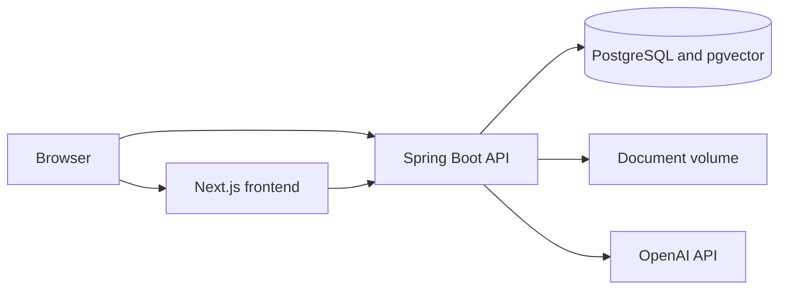

# WorkPilot AI

WorkPilot AI is a portfolio project for an operations workspace where an organization keeps tasks, documents, and follow-up in one place. The problem it addresses is the gap between a task list, a file folder, and an assistant that can see neither. The application keeps those records inside one organization and refuses to mix them with another organization's data.

## Architecture

A Next.js application in the browser talks to a Spring Boot API. The API stores accounts, memberships, tasks, documents, conversations, workflow runs, and notifications in PostgreSQL. Uploaded files stay on a volume, and the database stores the storage key. Chunk embeddings use the pgvector extension in the same database. Flyway applies migrations when the API starts. Hibernate only validates the schema.

The local stack is Docker Compose. A production overlay, which was not started, removes the published application ports and expects HTTPS in front of the containers. No public server was provisioned.

## AI integration

The assistant is optional. Without `OPENAI_API_KEY` the API returns a short message that the assistant is not configured, and it does not forward the provider's error body. With a key, chat uses `gpt-4o-mini` and embeddings use `text-embedding-3-small` at 1,536 dimensions. Retrieved passages are stored as sources and treated as untrusted data. If nothing relevant is found, the reply is marked as having no document support.

The assistant can list tasks and prepare a task. Preparing a task does not save it. The member confirms the title, priority, and due date, and the task service creates one task. Tool arguments cannot select an organization or a user. Each request allows three tool calls and a 15 second tool budget. Each member can send 40 messages per UTC day.

Document indexing is separate from upload. The screenshots show two text files whose extraction finished and whose indexing failed, because this local API was running without an embedding key.

## Security

Sessions use an HttpOnly `WORKPILOT_SESSION` cookie with `SameSite=Lax`. State-changing requests need a CSRF token. CORS allows listed origins and credentials. Passwords are BCrypt hashes. Organization resources are scoped to membership: a non-member receives 404, and a member without the required permission receives 403. Anonymous health checks omit database details. The production profile turns off Swagger, sets the session cookie secure by default, and refuses to baseline a database that has no Flyway history.

Sign-in does not lock an account after repeated failures. Sessions live in memory, so restarting the API signs users out. Those limits are documented in the README.

## What was implemented

Owners, admins, and members share an organization. Tasks follow a status lifecycle and can be assigned to a member. Documents accept a fixed set of types up to 10 MB, extract text from PDF and text-like files, and index chunks when embeddings are configured. The dashboard reads counts and completion days from the database.

Each organization starts with five workflow rules: notify an assignee, notify someone about an overdue task, process an upload, summarize a processed document, and send the previous day's task activity. The summary rule starts disabled. Runs keep a visible status, retry up to three times, and a failed run stays failed. Notifications belong to one user.

The screenshots in the README are from the local Dashboard Ops organization. They show the dashboard, task list, documents, an assistant conversation that saved a confirmed task, the workflow rules, and a history entry whose document summary failed because that rule was disabled. They are not a customer deployment, and the project has no public URL.
